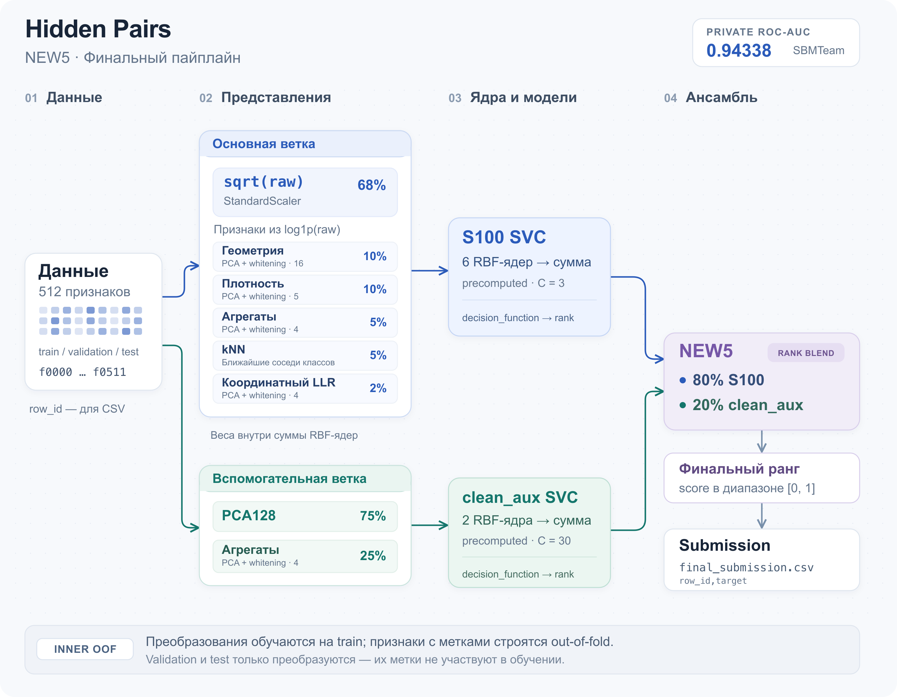

# Hidden Pairs — 28-е место

Решение соревнования [Week 03 — Hidden Pairs](https://www.kaggle.com/competitions/week-03-hidden-pairs) на Kaggle. Команда **SBMTeam**: Platon Usachev и Vsevolod Peretiatko. Вместе работали над признаками, валидацией, моделями и финальным submission.

Задача — по 512 анонимным числовым признакам определить, совпадают ли две скрытые визуальные сущности. Метрика — ROC-AUC. Итоговый результат команды: **28-е место, Private ROC-AUC 0.94338**.

| Решение | CV ROC-AUC | Validation ROC-AUC | Public ROC-AUC | Private ROC-AUC |
| --- | ---: | ---: | ---: | ---: |
| NEW5 — основной submission | 0.93430 | 0.95494 | 0.94110 | 0.94338 |
| Rescue T6 | 0.93356 | 0.95518 | 0.94228 | 0.94270 |

Разбор решения и результатов — в [презентации команды](https://www.figma.com/deck/86JEn2nMjXfgwNb3v63lXK/SBMTeam_presentation?node-id=2-35).

## Пайплайн



[Схема в SVG](docs/assets/pipeline.svg)

## Валидация

Использовали отдельные train и validation от организаторов. Для поиска и сравнения конфигураций — 5 повторов по 5 фолдов. Признаки с использованием меток строили out-of-fold, остальные преобразования обучали внутри фолдов. Validation и test в обучение не включали.

## Модели и признаки

Начали с EDA, проверки распределений и сравнения деревьев, Random Forest, GBDT и LightGBM. Затем перешли к SVC. Добавили агрегаты, расстояния до центров классов, признаки плотности и ближайших соседей, покоординатные статистики. PCA и whitening использовали для сжатия блоков и выравнивания масштабов. Параметры подбирали через RandomizedSearchCV и Optuna.

Для каждого блока строили своё RBF-ядро, складывали ядра с весами и обучали SVC на полученной матрице. Финальный **NEW5** смешивает ранги двух моделей: 80% веса получает S100 на `sqrt(raw)` и дополнительных признаках, 20% — отдельная SVC на PCA128 и агрегатах. Ранги делают предсказания компонентов сопоставимыми по масштабу.

Проверяли stacking, bagging, аугментации и очистку меток через Cleanlab. Устойчивого улучшения для финального решения они не дали. Второй финальный вариант — Rescue T6. Подробности и промежуточные результаты — в [истории экспериментов](docs/experiments.md).

**Стек:** Python, NumPy, pandas, SciPy, scikit-learn, LightGBM, Optuna, Cleanlab, Jupyter, Marimo.

## Структура

```text
final/         Финальный ноутбук, код обучения и зависимости
archive/       Исследовательские ноутбуки и предыдущие пайплайны
docs/          История экспериментов
data/          Конкурсные CSV, скачиваются отдельно
submissions/   Предсказания; legacy/ для промежуточных вариантов
```

## Воспроизведение

Нужен Python 3.14. Положить `train.csv`, `validation.csv`, `test.csv` и `sample_submission.csv` в `data/`, затем из корня проекта:

```bash
uv venv --python 3.14
uv pip install -r final/requirements.txt
uv run --no-project python final/final_model_runner.py --data-dir data --output-dir submissions
```

Основной файл — `submissions/final_submission.csv`. Пошаговый запуск и сравнение 10 моделей — в [финальном ноутбуке](final/final_submission_notebook.ipynb). Версии библиотек зафиксированы в [requirements.txt](final/requirements.txt).
